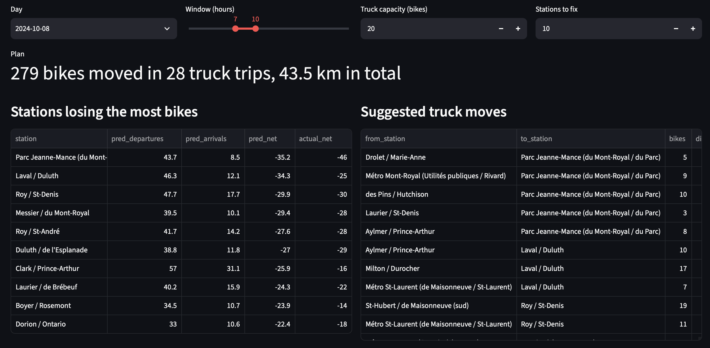
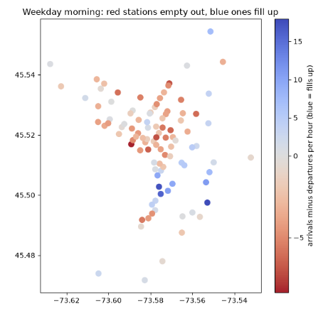
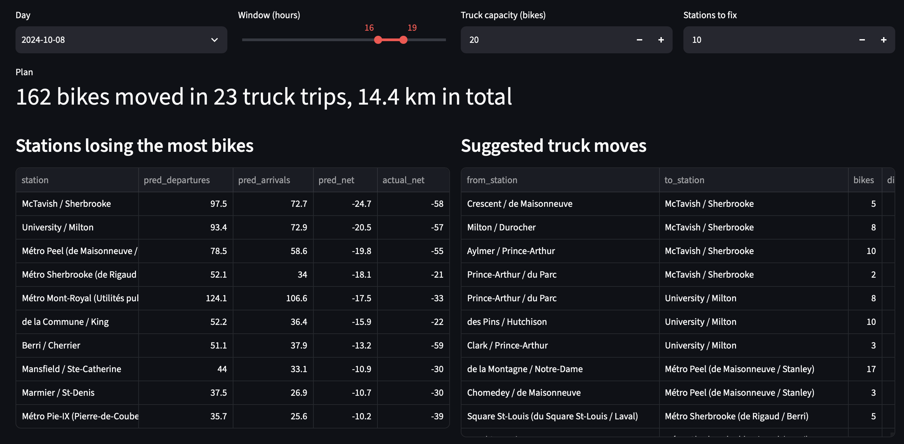
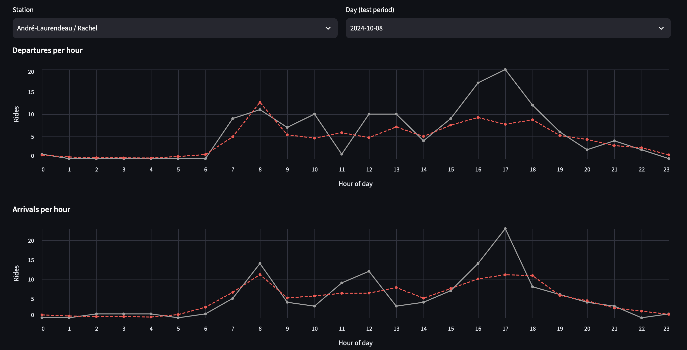
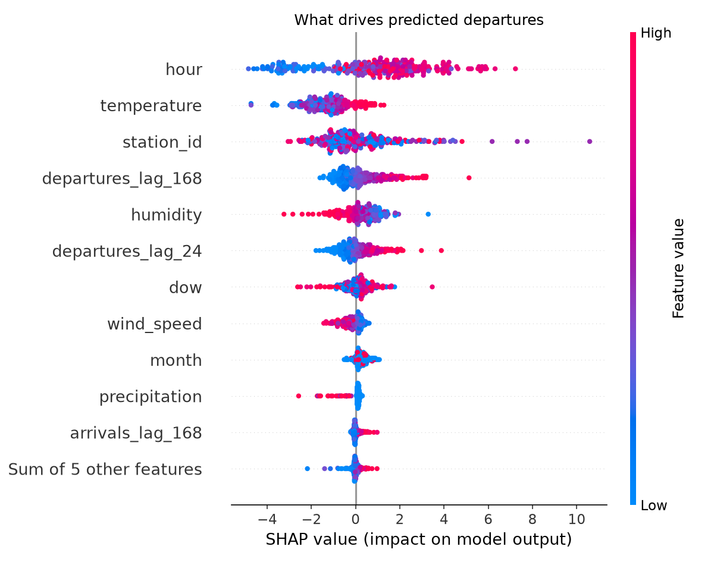

# BIXI Demand Forecast and Rebalancing

I built a model that predicts how many people will take and return BIXI bikes at Montreal's 100 busiest stations, every hour. Then I used those predictions to suggest where trucks should move bikes, so stations don't run empty.

I used only public data: [BIXI open data](https://bixi.com/en/open-data/) for 2024 and [Open-Meteo](https://open-meteo.com/) for weather.

## The problem

On weekday mornings, people ride from the Plateau to work downtown. So stations in the Plateau run out of bikes, and stations downtown get too full. In the evening it flips. BIXI fixes this by moving bikes with trucks. If you know ahead of time which stations will run out, you can plan those trucks better.

Red stations lose bikes in the morning. Blue stations gain bikes.

## What I did

1. **Got the data.** I took about 13.3 million bike trips from 2024 and counted how many bikes left and arrived at each station every hour. I added the weather for each hour and marked holidays.
2. **Looked at the data first.** Weekdays have two busy times, around 8 am and 5 pm. People ride more when it's warm. Rainy hours have about a third of the rides of dry hours.
3. **Split by time.** I trained the model on April to September and tested it on October and November. I didn't mix the dates up, because in real life you can't learn from the future.
4. **Compared three models.**
   * A simple guess: "same as this hour last week"
   * A straight line model (ridge regression)
   * Gradient boosting, tuned with Optuna
5. **Explained the model** with SHAP, to see what affects each prediction.
6. **Made a truck plan.** For each station, I predicted arrivals minus departures. Stations that will lose the most bikes get bikes from the nearest station that has extra.
7. **Built a small web app** with Streamlit to show all of this.

## Results

Tested on October and November 2024:

| Model | Average error, bikes taken | Average error, bikes returned |
|---|---|---|
| Same as last week | 3.34 | 3.14 |
| Straight line model | 3.00 | 2.82 |
| **Gradient boosting** | **2.53** | **2.58** |

The error is how many bikes the prediction is off by, on average, for one station in one hour. Gradient boosting has 24% less error than the simple guess for bikes taken, and 18% less for bikes returned.

**One real day:** on Tuesday October 8, the model picked the 10 stations that would lose the most bikes between 7 and 10 am. All 10 did lose bikes, and most were within a few bikes of the prediction. The plan moves 279 bikes in 28 truck trips.

In the evening, the model correctly predicts the opposite: downtown runs out and the Plateau fills up.

## What affects bike demand

* **Time of day matters most.** Busy at rush hour, almost nobody at night.
* **Cold weather** means fewer rides.
* **Rain** cuts rides a lot, but it doesn't rain often, so it shows up lower in the chart.
* **Last week and yesterday** at the same hour are good hints for now.

## What it doesn't do well yet

* **It guesses too low at the busiest hours.** It gets the shape of the day right, but not the very top of the peaks.
* **Tuning didn't help for returns.** I tuned on late September, but October and November were colder and different. Testing on several time windows would work better.
* **It uses the real weather, not a forecast.** A real system would only have the weather forecast.
* **It doesn't know how many docks each station has.**
* **The truck plan is simple.** It fixes the worst station first. A smarter method could find shorter routes.

## How to run it

~~~
conda create -n bixi python=3.12 -y
conda activate bixi
pip install -r requirements.txt
python -m src.download          # get the data
python -m src.build_dataset     # count bikes per station per hour
python -m src.train             # train the models
python -m src.explain           # make the SHAP charts
python -m src.recommend         # make a truck plan
streamlit run app/streamlit_app.py
python -m pytest                # run the tests
~~~

## Folders

~~~
src/        the main code
app/        the web app
notebooks/  data exploration
tests/      tests
docs/       screenshots
~~~
